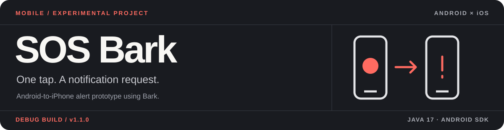
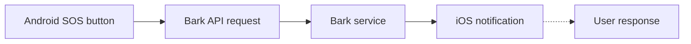

<p align="center"></p>

<p align="center">
<a href="https://github.com/burakyurday/sos-bark/actions/workflows/build-apk.yml"></a>


</p>

## Overview

**SOS Bark** is a lightweight Android application that sends a notification request to an iPhone through the Bark service. It is an experimental personal communication tool, not an emergency-response system.

> **Important:** A successful Bark API request does not prove delivery to the iPhone. Network availability, iOS notification permissions and Bark service availability matter. In an actual emergency, call the official emergency number (112 in Türkiye).

## How it works



The Android device initiates the request. The recipient must configure Bark and its iOS notification permissions separately.

## Download & setup

[Download the Android debug APK](https://github.com/burakyurday/sos-bark/raw/refs/heads/main/downloads/SOS-RedmiNote8-v1.1.0.apk) · [Build workflow](https://github.com/burakyurday/sos-bark/actions/workflows/build-apk.yml) · [Türkçe kurulum](GITHUB-APK.md)

- Android 8.0 or newer (minimum SDK 26); Redmi Note 8 is the intended test device.
- The APK is debug-signed, not an official store release. Review the source and build evidence before installing.
- Install Bark on the receiving iPhone and configure notification permissions.
- Enter the Bark key locally in the Android app and use the test button before any use. Never commit the key.

CI artifacts are also available in [the successful build](https://github.com/burakyurday/sos-bark/actions/runs/43187164753) as `SOS-RedmiNote8-v1.1.0-APK`. GitHub Actions artifacts expire after seven days.

## Development

`Java 17` · `Android SDK 35` · `Gradle 8.9` · `Bark API`

With JDK 17, Android SDK 35 and Gradle installed:

```sh
gradle --no-daemon :app:assembleDebug
```

The build workflow verifies APK integrity, alignment and debug signature, then performs an Android 10 emulator installation check. Physical device behavior and actual iPhone delivery are separate validation steps.

## Project status

- [x] Android debug build and artifact packaging
- [x] CI Android 10 emulator installation check
- [ ] Production signing and stable update identity
- [ ] Verified end-to-end notification delivery on the intended devices

Read [security and safe use](SECURITY.md) and [version notes](CHANGELOG.md).

---

<p align="center"><sub>MOBILE EXPERIMENT · MUTFAK AJANS</sub></p>
